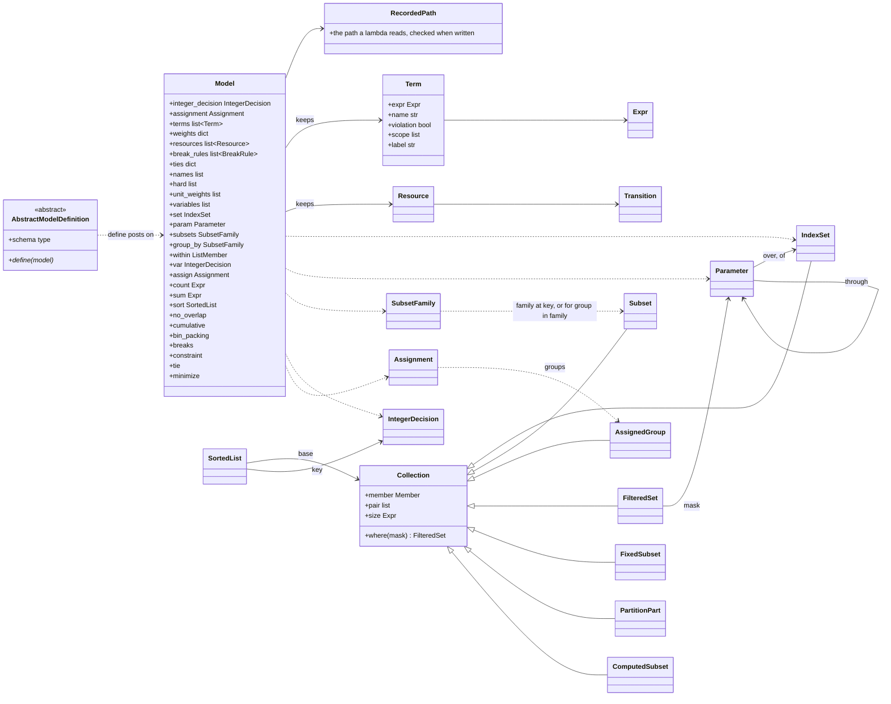
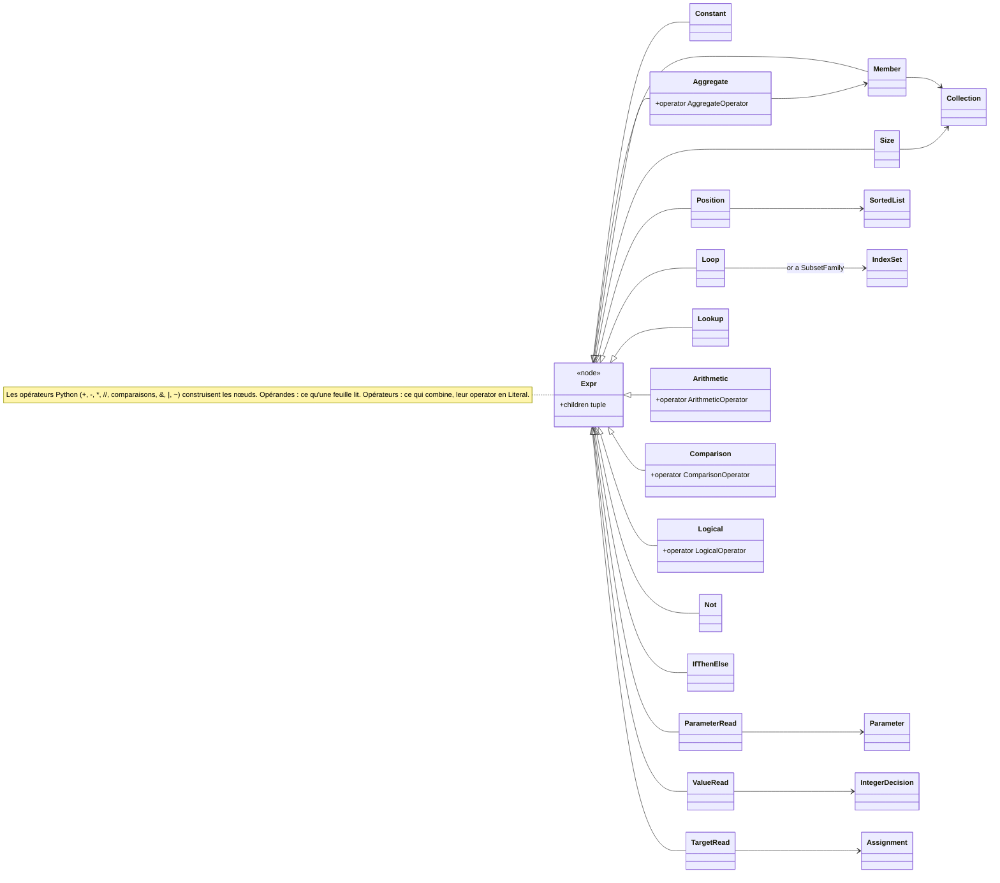
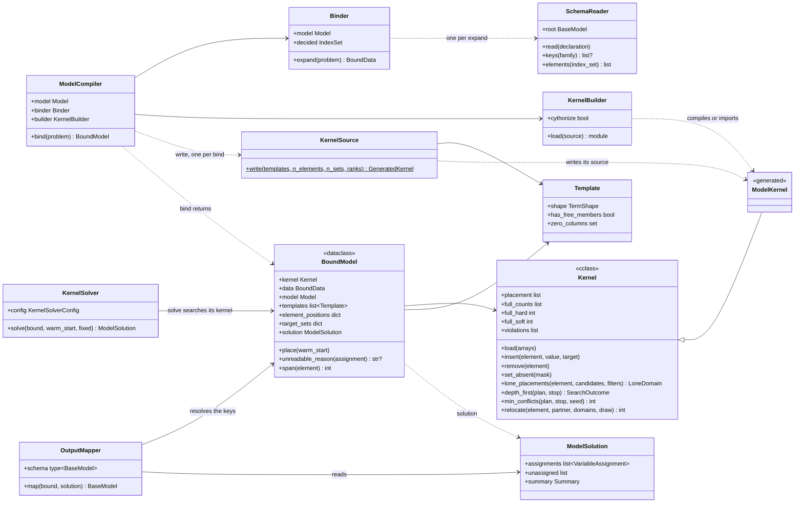
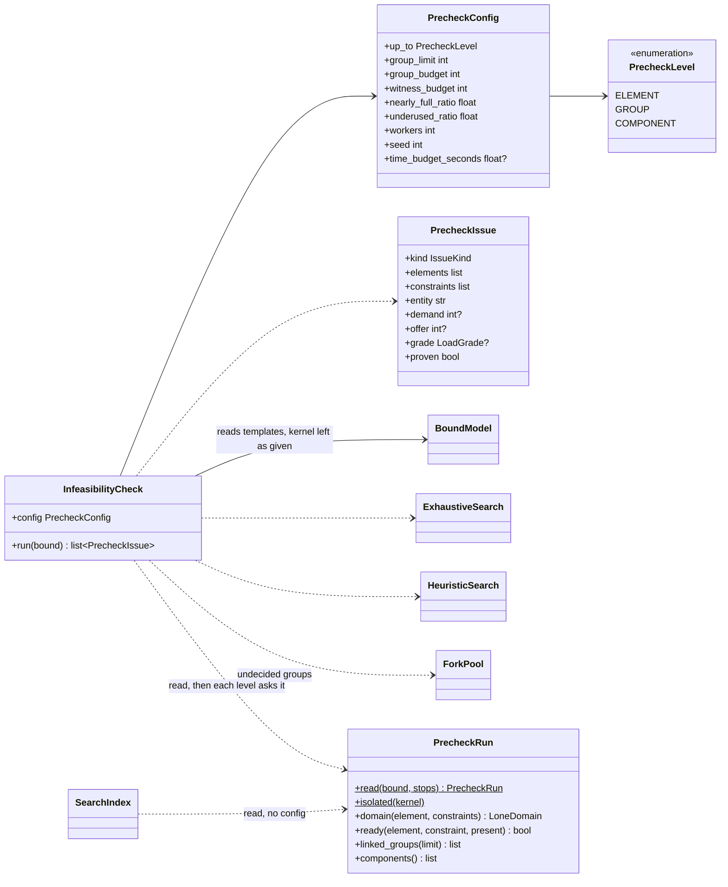

# Moteur de modélisation générique

Un modèle s'écrit une fois, sans données, avec des déclarations (ensembles, paramètres, familles,
décisions) et des règles. Il est compilé en un noyau Cython, celui que la recherche utilise, puis lié à
l'objet Pydantic du problème. Le moteur ne connaît aucun problème : tout ce qui nomme un problème vit
dans le modèle de ce problème.

L'exemple de ce document est un **atelier** (*job shop*). Des commandes (*jobs*) sont faites
d'opérations. Chaque opération dure un certain temps, se fait sur une des machines qui savent la faire,
dans sa fenêtre de temps, et après l'opération précédente de sa commande. Une machine ne fait qu'une
opération à la fois. Le modèle d'essai correspondant est `tests/core/optimization/job_shop_model.py`.

L'historique du projet où le moteur est né (décisions, mesures, revues) est dans
`docs/history/optimization-engine-log.md`. Les règles de revue générales sont dans `docs/rules.md` ;
celles du moteur sont à la section 8.

## 1. Où vit le code

```
src/baseline_core/core/optimization/
  problem_formulation/            comment un problème s'écrit
    model.py                      Model : déclarations, décisions, règles, primitives de ressource
    abstract_model_definition.py  AbstractModelDefinition : un modèle écrit contre un type de schéma
    expression.py                 Expr, Constant, Lookup et les opérateurs, en Literal, comme le code généré
    declaration.py                IndexSet, Parameter, SubsetFamily, Subset, Assignment, IntegerDecision ;
                                  RecordedPath, Collection, et les opérandes qui les lisent
    term.py                       Term : une règle ou un terme d'objectif, nommé
  solver/                         comment un modèle écrit est résolu
    binding/                      un modèle rencontre ses données : compilé une fois, lié à chaque problème
      model_compiler.py           ModelCompiler, BoundModel
      binder.py                   Binder : déplie chaque règle sur les données
      bound_collection.py         FixedSubset, PartitionPart, ComputedSubset : les collections liées
      schema_reader.py            SchemaReader : lit les valeurs dans l'objet Pydantic
    model_solution.py             VariableAssignment, ModelSolution : ce qu'une résolution prend et rend, en clés
    output_mapper.py              OutputMapper : remplit la sortie qu'un problème déclare
    score.py                      Score : dur puis mou
    stop_condition.py             MaxIterations, MaxTime, NoImprovement, AnyOf : quand une recherche s'arrête
    kernel/
      kernel.py                   Kernel : le noyau écrit à la main (Cython « mode Python pur »)
      kernel_source.py            KernelSource : écrit la sous-classe générée du modèle
      model_kernel.py             ModelKernel : le gabarit de la sous-classe, que KernelSource remplit
      shape.py                    TermShape, Template : les formes que le code généré partage
      kernel_builder.py           KernelBuilder : compile (ou importe en Python pur), cache disque
    infeasibility/
      infeasibility_check.py      InfeasibilityCheck, PrecheckConfig, PrecheckLevel : la pré-vérification
      precheck_run.py             PrecheckRun : une exécution, ce que les règles dures lient
      placement_search.py         ExhaustiveSearch, HeuristicSearch : la recherche d'un groupe
      fork_pool.py                ForkPool : les groupes indécis cherchés dans des copies du processus
      precheck_issue.py           PrecheckIssue : un constat
    search/                       la recherche détruire-réparer (ALNS) sur le noyau
      search_index.py             SearchIndex : domaines seuls, et les liens (Tie) que le modèle déclare
      kernel_solver.py            KernelSolver, KernelSolverConfig : la boucle, gardant les coups pas pires
      kernel_state.py             KernelState : le noyau, et une copie de son placement
      kernel_evaluator.py         KernelEvaluator : un coup compté autour des éléments déplacés
      destroy_repair.py           DestroyRepair, Release : libère, replace au mieux, aligne les paires
      destroy_selector.py         DestroySelector, AlnsConfig : les bras de destruction, pondérés par roulette
  mining/                         apprendre les règles d'un planificateur à partir de ses plans
    plan.py                       Plan ; PlanView : les clés des tables de plans, par rôle, et le découpage en périodes
    findings.py                   Findings : le findings.json d'une analyse des plans, lu en candidats
    candidate.py                  Candidate : une règle trouvée et la règle dure qu'elle pose ;
                                  ConstrainedDefinition : un modèle et ses candidats
    sampler.py                    AbstractPlanSampler ; FeasibleWalk, KernelRestarts : des plans de référence
    constrain_loop.py             ConstrainLoop : encoder d'abord ce que le modèle explique le moins bien
    objective_tradeoff.py         ObjectiveTradeoff : deux objectifs, dans quel sens les plans ont bougé
src/baseline_core/service/optimization/
  optimization_service.py         OptimizationService : lier une fois, pré-vérifier, résoudre, remplir la sortie
tests/core/optimization/          même découpage ; les modèles d'essai à la racine
  job_shop_model.py               l'atelier
  bin_packing_model.py            des colis chargés dans des camions, sans temps
  resource_model.py               chaque primitive de ressource, activable une à une
  mining/shop.py                  un petit atelier pour les essais de mining/
```

Le noyau importe `cython` et `numpy`, qui ne sont pas des dépendances de ce dépôt :

```bash
uv run --with cython --with numpy pytest tests/core/optimization
uv run ruff check --no-fix src/baseline_core/core/optimization
uv run mypy src/baseline_core/core/optimization
```

> Les essais de `tests/core/optimization/` tournent sur des modèles génériques : l'atelier
> (`job_shop_model.py`) et des équipes qui font des tâches à des postes (`crew_model.py`).

## 2. Écrire un modèle, le résoudre

Le schéma est un simple `BaseModel` ; le moteur le lit sans le connaître.

```python
class Machine(BaseModel):
    code: str


class Operation(BaseModel):
    ref: str                  # sa clé
    job: str                  # la commande dont elle fait partie
    step: int                 # son rang dans la commande
    duration: int
    machines: list[str]       # les machines qui savent la faire
    release: int              # au plus tôt
    due: int                  # au plus tard


class Shop(BaseModel):
    machines: list[Machine]
    operations: list[Operation]
```

Le modèle est une sous-classe d'`AbstractModelDefinition` (une ABC) : `schema` donne le type des
données, `define` pose les règles, sans données. Sa configuration arrive au constructeur.

```python
class JobShopDefinition(AbstractModelDefinition[Shop]):
    schema = Shop

    def __init__(self, horizon: int) -> None:
        self.horizon = horizon

    def define(self, model: Model[Shop]) -> None:
        operations = model.set(lambda s: s.operations, key="ref")
        machines = model.set(lambda s: s.machines, key="code")

        duration = model.param(lambda op: op.duration, operations)
        step = model.param(lambda op: op.step, operations)
        release = model.param(lambda op: op.release, operations)
        due = model.param(lambda op: op.due, operations)
        options = model.subsets(lambda op: op.machines, operations, of=machines)

        start = model.var("start", operations, span=duration, high=self.horizon)
        machine = model.assign("machine", operations, machines, among=options)

        operation = operations.member
        model.constraint(
            (release[operation] <= start[operation]) & (start.end(operation) <= due[operation]),
            name="time_window",
        )
        model.no_overlap(machine, start, name="no_machine_overlap")

        for job in model.group_by(lambda op: op.job, operations):
            first, second = job.pair
            model.constraint(
                ((step[first] >= step[second]) | (start.end(first) <= start[second]))
                & ((step[second] >= step[first]) | (start.end(second) <= start[first])),
                name="job_order",
            )

        model.minimize(start.end(operation), name="completion", weight=1)
```

Deux décisions par opération : `start`, un intervalle `[start, start + duration)`, et `machine`, une
cible prise parmi `options`. `time_window` et `job_order` sont des expressions ordinaires ;
`no_machine_overlap` est une primitive du catalogue (section 3) ; `completion` est un terme souple.

**La résolution.** Tout se configure au constructeur ; les méthodes reçoivent les données.

```python
compiled = ModelCompiler(JobShopDefinition(horizon=40))    # une fois ; cythonize=False : Python pur
bound = compiled.bind(shop)                                # à chaque problème : un BoundModel

check = InfeasibilityCheck(PrecheckConfig(up_to=PrecheckLevel.GROUP, time_budget_seconds=20))
issues = check.run(bound)                                  # ce que les règles dures rendent impossible

solver = KernelSolver(KernelSolverConfig())
solution = solver.solve(bound, warm_start, fixed)          # ModelSolution, en clés
schedule = OutputMapper(Schedule).map(bound, solution)     # le schéma de sortie, rempli
```

`OptimizationService` (`src/baseline_core/service/optimization/optimization_service.py`) enchaîne ces quatre étapes
sans nommer le problème. La pré-vérification, le solveur et la sortie lisent le même modèle lié :
lier est l'étape coûteuse, et un `BoundModel` ne naît que de `ModelCompiler.bind`, donc son type
suffit à garantir qu'il est lié.

**La sortie est une configuration.** Une affectation n'a qu'une forme, `VariableAssignment`
(`element`, `value`, `target`, par les clés que déclarent les ensembles) : elle voyage en JSON et se
redonne en `warm_start` ou en `fixed`. Le problème déclare sa sortie dans un `BaseModel` dont chaque
champ dit où il lit par son alias, dans une entrée `assigned` par élément placé (`element`, `value`,
`end`, `target`) :

```python
class ScheduledOperation(BaseModel):
    model_config = ConfigDict(validate_by_name=True)

    ref: str = Field(validation_alias=AliasPath("element", "ref"))
    start: int = Field(validation_alias="value")
    end: int
    machine: str = Field(validation_alias=AliasPath("target", "code"))


class Schedule(BaseModel):
    operations: list[ScheduledOperation] = Field(validation_alias="assigned")
```

`OutputMapper(schema).map(bound, solution)` résout les clés sur le problème lié et remplit le
schéma, sans code propre au problème ni classe de base à hériter. Un champ lu par `AliasPath` demande
`ConfigDict(validate_by_name=True)` : sans lui, le greffon mypy de Pydantic refuse l'alias. Le même
réglage permet de relire une sortie depuis son propre JSON, écrit par noms de champs.

**Une seule façon d'écrire chaque chose** (aucune surcharge `@overload`) :

| Écriture | Sens |
|---|---|
| `operations.member`, `job.pair` | un membre libre, une paire libre : chaque accès en crée de nouveaux, qui parcourent tous les membres ou toutes les paires de membres distincts (propriétés) |
| `group.size` | le nombre de membres d'une collection |
| `model.count(x, condition)` | les membres `x` où la condition tient |
| `model.sum(x, valeur)`, `model.min(x, valeur)` | somme, minimum sur les membres |
| `model.largest(a, b, …)`, `model.smallest(a, b, …)` | le plus grand, le plus petit de quelques valeurs |
| `model.exists([...])`, `model.forall([...])` | au moins une, toutes vraies |
| `model.if_then_else(condition, a, b)` | une valeur selon une condition |
| `model.sort(group, key=start)` puis `order.previous`, `order.current` | deux membres consécutifs, dans l'ordre d'une décision |
| `param[x]`, `start[x]`, `start.end(x)`, `machine[x]` | un paramètre, une décision, une fin d'intervalle, une cible, lus en un membre |
| `model.group_by(lambda op: op.job, operations)` | un sous-ensemble par valeur de la clé |
| `for job in family`, `for group in machine.groups` | les deux seules boucles dépliées : une instance par sous-ensemble ou par cible |
| `model.constraint(expr, name=, scope=group)`, `model.minimize(expr, name=, weight=)` | dure ; souple, pondérée |
| `sum([...])` (Python) | des expressions additionnées |

**Garde-fous.** Une expression refuse d'être évaluée comme vrai ou faux : `if`, `and`, `or` et `in`
sur une expression lèvent `TypeError` ; on écrit `&`, `|`, `~` et `model.if_then_else`. Un second
`model.var` ou `model.assign` est refusé : le noyau tient une valeur et une cible par élément.

## 3. Le catalogue : des primitives génériques seulement

| Méthode | Sens | Référence |
|---|---|---|
| `model.no_overlap(groups, interval, name=, where=, transition=)` | deux intervalles d'un même groupe ne se chevauchent pas | CP-SAT `AddNoOverlap`, MiniZinc `disjunctive` |
| `model.cumulative(groups, interval, demand, capacity, name=)` | à tout moment, la somme des `demand` des intervalles en cours d'un groupe reste sous `capacity` | CP-SAT `AddCumulative`, MiniZinc `cumulative` |
| `model.bin_packing(assignment, demand, capacity, name=)` | sans temps : ce qu'une cible reçoit ne dépasse pas sa capacité | CP Optimizer `pack` |
| `model.breaks(groups, interval, name=, period=, window=, length=, where=)` | chaque période où un groupe travaille, il garde `length` créneaux libres consécutifs dans `window` | pauses de véhicules d'OR-Tools (`SetBreakIntervalsOfVehicle`) |
| `Transition(kind, same, other)`, passé à `no_overlap` | l'attente entre deux membres consécutifs d'un groupe, selon que leurs sortes sont égales ou non | distances de transition de CP Optimizer |

`groups` est une famille (un groupe par sous-ensemble), une affectation (un groupe par cible) ou une
collection (un seul groupe). `demand` et `capacity` sont un nombre ou un paramètre ; une capacité par
cible n'a de sens que sur une affectation (`ValueError` sinon). `where=` restreint une primitive aux
éléments qu'un paramètre marque. Sur l'atelier :

```python
job_of = model.param(lambda op: op.job, operations)        # un texte sans of= : une catégorie
model.no_overlap(machine, start, name="no_machine_overlap",
                 transition=Transition(job_of, same=0, other=1))  # 1 créneau de réglage entre commandes
model.cumulative(operations, start, demand=1, capacity=2, name="operators")  # 2 opérateurs en tout
model.breaks(machine, start, name="maintenance", period=8, window=[3, 6], length=1)
```

`model.var` demande toujours un horizon (`high`) : la recherche et la pré-vérification en listent
chaque valeur ; `breaks` le veut en périodes entières. Chaque primitive pose ses expressions dans le
modèle et s'inscrit dans `model.resources` (ou `model.break_rules`), que la pré-vérification lit
(section 6). `model.tie(name, Tie.…)` dit à la recherche de déplacer ensemble les éléments qu'une
contrainte lie.

**Règle d'entrée au catalogue** : une contrainte n'y entre que si c'est une primitive d'un outil de
référence (CP-SAT, CP Optimizer, MiniZinc, OR-Tools), vérifiée avant d'être citée. Un besoin propre à
un problème (une pause de midi, un temps de nettoyage) passe par une primitive déclarée (`breaks`,
`Transition`) ; une règle propre à un problème s'écrit en expressions ordinaires dans son modèle,
comme `job_order` plus haut.

## 4. Lire le schéma

Si l'atelier liste aussi ses commandes (`jobs: list[Job]`, `Job(name, due)`) et donne à chaque
opération des fenêtres (`windows: list[Window]`, `Window(start, end)`) :

| Déclaration | Sens |
|---|---|
| `model.set(lambda s: s.operations, key="ref")` | les éléments d'une liste ; `key` est le champ qui les nomme (texte ou entier : une clé voyage en texte) |
| `model.param(lambda op: op.job, operations, of=jobs)` | un texte (ou un objet) qui nomme un élément de `jobs` devient sa position ; un nom inconnu est refusé |
| `model.param(lambda op: op.job, operations)` | un texte sans `of=` est une catégorie : seule l'égalité compte |
| `model.param(lambda op: jobs[op.job].due, operations)` | la jointure sur la clé d'un ensemble, dans la lambda |
| `model.param(lambda op: op.machines[0], operations, of=machines)` | un élément d'une liste, par position |
| `model.set(lambda s: [w for op in s.operations for w in op.windows], distinct=True)` | des objets égaux (copies) comptent une seule fois ; deux ensembles sur la même liste, l'un `distinct`, l'autre non, se lisent chacun à part |
| `model.subsets(lambda op: op.machines, operations, of=machines)` | par élément, un sous-ensemble de `of` |
| `model.assign("machine", operations, machines, among=options)` | le domaine déclaré : les cibles que chaque élément peut prendre |
| `model.group_by(lambda op: op.job, operations, same_order_as=)` | un sous-ensemble par valeur de la clé (une liste de clés : l'élément rejoint chacune) ; `same_order_as` suit l'ordre des clés d'un autre regroupement |
| `window = model.within(lambda op: op.windows, operation)` | un membre de la liste lue sur un élément ; `window.start` lit son champ |
| `model.lookup_table([3, 1])[job[operation]]` | une valeur donnée dans le modèle, lue à une position |

Les `RootModel` qui enveloppent une liste, les propriétés et les `cached_property` se lisent comme
des champs. Un chemin faux est refusé au moment où le modèle est écrit (`RecordedPath`).

## 5. Le noyau : un seul code, compilé ou en Python pur

`solver/kernel/kernel.py` est écrit en Cython « mode Python pur » : le même fichier se compile avec
Cython ou s'exécute tel quel. Pour un modèle, `KernelSource` écrit le texte de `kernel.py` suivi
d'une sous-classe `ModelKernel` générée (ses tableaux et cinq blocs : `_around`, `_full`,
`_around_set`, `_constants`, `_violations`). `KernelBuilder` compile ce texte avec Cython, une fois
par source, en cache disque (`~/.cache/modeling`, ou `MODELING_KERNEL_CACHE`), ou l'importe tel quel
en Python pur (`ModelCompiler(definition, cythonize=False)`). `Kernel.COMPILED` dit lequel tourne. Le
texte dépend du modèle seul, jamais des données.

Il n'y a pas d'interpréteur. Le noyau compte les règles sans décision (`_constants`) et rend les
violations en mots (`kernel.violations`, avec les objets du schéma). Le même code tourné en Python
pur sert de témoin au code compilé ; la référence indépendante est un compte écrit à la main en
Python dans les essais (`TestDeliveries`, `tests/core/optimization/solver/binding/model_compiler_test.py`).

Le noyau compte en entiers : un nombre du modèle ou des données qui n'est pas entier (`x >= 2.5`,
`x * 0.5`) est refusé à la liaison (`ValueError`), jamais tronqué. `cdivision=False` : `//` arrondit
vers le bas, compilé ou non. La liaison suspend le ramasse-miettes (`gc`) ; la première allocation
qui suit paie la collecte différée.

## 6. Pré-vérification (`solver/infeasibility/infeasibility_check.py`)

`InfeasibilityCheck(PrecheckConfig(up_to=..., time_budget_seconds=...)).run(bound)` rend des
`PrecheckIssue` : ce que les règles dures rendent impossible, avant toute recherche. Chaque constat
nomme les règles qui **suffisent** à le prouver, et l'entité en cause par son nom dans les données
(`entity`). Sur l'atelier, une opération `b2` de durée 4 dont la fenêtre finit à 3 donne
`PrecheckIssue(kind=NO_PLACEMENT, entity="b2", constraints=["time_window"])`.

**Délai.** Une exécution ne dépasse pas `PrecheckConfig.time_budget_seconds`, s'il est réglé ; il n'y
a pas de défaut. Sans réglage, l'appelant accepte d'attendre que chaque recherche atteigne son plafond
(`group_budget`, `witness_budget`). Le délai est un `MaxTime` (`solver/stop_condition.py`), armé au début de
`run`, consulté entre les éléments, entre les groupes, dans la recherche du noyau (toutes les 4 096
évaluations, `MaxTime.CLOCK_STRIDE`) et dans les explications. Ce qui n'est pas décidé à temps n'est
pas prouvé. La liaison se fait avant `run` : elle ne compte pas.

**Ce qui lie des éléments, pour tout modèle.** Chaque gabarit publie, par instance, `members` (le
domaine de ses membres libres) et `reads` (ce que lit chaque évaluation en plus). Une instance de paire
lie ses membres ; une instance de membre lie ses membres à ce qu'elle lit ; toute instance lie ce
qu'elle lit. Une règle n'est lue autour d'un élément qu'une fois placés tous les éléments que lisent
ses instances qui le touchent. Un ensemble décidé compte pour tous les éléments qui peuvent y aller.
Aucune lecture partielle n'est donc fausse, et aucune hypothèse de monotonie n'est faite.

**Jusqu'où aller : `PrecheckConfig.up_to`**, un `PrecheckLevel`. Chaque niveau fait tourner ceux
d'avant, du moins coûteux au plus coûteux ; `COMPONENT` (le défaut) les fait tous.

| `up_to` | Ce que la pré-vérification cherche |
|---|---|
| `PrecheckLevel.ELEMENT` | chaque élément seul, et la charge de chaque ressource (sans recherche) |
| `PrecheckLevel.GROUP` | puis chaque petit groupe qu'une règle dure lie (au plus `group_limit` éléments) |
| `PrecheckLevel.COMPONENT` | puis chaque composante : les éléments que les règles dures lient de proche en proche, de toute taille, la plus petite d'abord |

**Niveau 1, élément seul** : ses débuts et ses cibles possibles, filtrés par les règles qui ne lisent
que lui. Tous les débuts d'un élément sont essayés en un seul appel compilé (`Kernel.lone_placements`).

**Niveau 1, charges.** Pour chaque primitive de `model.resources`, des bornes linéaires, sans
recherche, tirées des domaines du niveau 1 :

- **par élément** : une demande plus grande que la capacité de toutes les cibles qu'il peut prendre
  (`NO_PLACEMENT`) ;
- **par groupe fixe** (une famille d'éléments, ou l'ensemble entier) : la somme des durées × demandes
  contre ce que la capacité offre (`GROUP_LOAD`) ;
- **par ensemble de cibles** (sur une affectation) : les éléments qui ne peuvent aller que dans ces
  cibles demandent au plus ce qu'elles offrent, une condition de Hall (`POOL_LOAD`) ; une cible
  qu'aucun élément ne peut prendre est signalée avec une demande nulle ;
- **sans temps** (`bin_packing`) : la même borne, avec la capacité seule.

L'offre est comptée sur les créneaux que les membres peuvent réellement occuper, en morceaux entiers
de leurs durées, moins les pauses (`breaks`) ; une `Transition` ajoute l'attente minimale entre deux
membres d'une même cible. Cette offre est plus serrée que la capacité de tout l'horizon, et reste une
preuve sûre. Chaque charge reçoit une note (`LoadGrade`) : `OVERLOADED` au-delà de l'offre (une
preuve), `NEARLY_FULL` au-delà de `nearly_full_ratio`, `UNDERUSED` sous `underused_ratio` pour un
ensemble de cibles (deux avertissements, sans preuve).

**Niveaux 2 et 3 : chaque groupe et chaque composante passent par trois étapes.**
1. Une recherche en profondeur qui lit tout dès qu'un élément est placé. Elle ne fait que guider : un
   placement trouvé est vérifié exactement.
2. Si elle cale, une recherche locale (`Kernel.min_conflicts` : moindres conflits, un coup sur dix au
   hasard, tirage fixe). Un placement trouvé suffit. Aucune de ces deux étapes ne prouve
   l'impossibilité.
3. Sinon, la preuve exacte (`Kernel.depth_first`) : en profondeur, avec élagage en avant. Chaque
   placement retire aux éléments suivants les candidats qu'il interdit, et une liste vide fait
   reculer.

Les groupes qui restent indécis sont cherchés en parallèle dans des copies du processus (`ForkPool`,
`PrecheckConfig.workers`, au plus le nombre de cœurs moins deux). Un groupe dont la recherche est
coupée est rendu `UNDECIDED` : rien n'est prouvé.

**Explication** : on part des seules règles qui ont rejeté quelque chose pendant la preuve, puisque
les autres n'ont pas agi. On retire chacune à tour de rôle, avec le budget de la preuve ; un essai non
décidé garde la règle. Passé l'échéance, on garde le reste. Le résultat reste sûr.

## 7. Carte des classes

`<|--` est un héritage, `-->` « contient ou lit », `..>` « produit ou crée ».

### 7.1 Écrire un modèle (`problem_formulation/`)





### 7.2 Compiler, lier et résoudre (`solver/`)



### 7.3 Prouver l'infaisabilité (`solver/infeasibility/`)



### 7.4 Chaque classe en une ligne

Les chemins partent de `src/baseline_core/core/optimization/`.

| Classe | Fichier | Ce qu'elle fait |
|---|---|---|
| `AbstractModelDefinition` | `problem_formulation/abstract_model_definition.py` | ABC : un type de schéma et `define(model)` |
| `Model`, `Tie`, `Transition`, `Resource`, `BreakRule` | `problem_formulation/model.py` | écrit le problème : déclarations, une décision entière, une affectation, règles et termes, primitives ; tient les noms, poids et niveaux des contraintes (`names`, `hard`, `unit_weights`, `variables`) |
| `RecordedPath`, `SchemaPath` | `problem_formulation/declaration.py` | le chemin qu'une lambda lit dans le type du schéma, refusé s'il est faux |
| `Term` | `problem_formulation/term.py` | une expression, sa contrainte ; compte de violations ou somme |
| `Expr`, `Constant`, `Lookup` et les opérateurs | `problem_formulation/expression.py` | `Arithmetic`, `Comparison`, `Logical`, `Not`, `IfThenElse`, leur `operator` en `Literal` ; rien au-dessus |
| Les opérandes qui lisent une déclaration | `problem_formulation/declaration.py` | `Member`, `Position`, `Loop`, `ParameterRead`, `ValueRead`, `TargetRead`, `Size`, `Aggregate` |
| `Collection`, `FilteredSet`, `SortedList` | `problem_formulation/declaration.py` | ce qu'on parcourt ; filtré par un masque ; trié par la décision entière |
| `IndexSet`, `Parameter`, `SubsetFamily`, `Subset`, `Assignment`, `AssignedGroup`, `IntegerDecision` | `problem_formulation/declaration.py` | les déclarations et les deux décisions |
| `ModelCompiler`, `BoundModel` | `solver/binding/model_compiler.py` | écrit le modèle une fois ; à chaque `bind`, déplie, regroupe par forme, génère, construit et remplit le noyau ; le noyau lié et ce que la liaison a lu, clés vérifiées une fois |
| `Binder`, `BoundData`, `Expansion` | `solver/binding/binder.py` | lit les déclarations et déplie chaque règle sur les données (une sonde + les instances) ; les données du problème telles que le modèle les lit, en positions |
| `FixedSubset`, `PartitionPart`, `ComputedSubset`, `BoundFilteredSet` | `solver/binding/bound_collection.py` | les collections liées |
| `SchemaReader`, `ElementIndex`, `Nested` | `solver/binding/schema_reader.py` | lit les valeurs d'un objet Pydantic et les garde, un index par ensemble (chemin, clé, `distinct`) |
| `VariableAssignment`, `TermSummary`, `Summary`, `ModelSolution` | `solver/model_solution.py` | une solution en clés seulement, qui survit au JSON et se redonne en `warm_start` ou `fixed` |
| `OutputMapper` | `solver/output_mapper.py` | remplit la sortie qu'un problème déclare par alias (un `BaseModel`), les clés résolues sur le problème lié |
| `TermShape`, `TermKind`, `BoundStatement`, `Template` | `solver/kernel/shape.py` | la forme d'une instance ; un énoncé lié ; toutes les instances d'une forme (un bloc de code généré) |
| `KernelSource`, `GeneratedKernel` | `solver/kernel/kernel_source.py` | écrit le module d'un modèle (`kernel.py` + la sous-classe générée) et ses tableaux |
| `KernelBuilder` | `solver/kernel/kernel_builder.py` | compile le texte avec Cython, ou l'importe en Python pur ; cache disque partagé entre processus |
| `Kernel` / `ModelKernel` | `solver/kernel/kernel.py` / `model_kernel.py` | le noyau écrit à la main (comptes, variations, `lone_placements`, `depth_first`, `min_conflicts`, `relocate`) / le gabarit des blocs propres au modèle |
| `InfeasibilityCheck`, `PrecheckConfig`, `PrecheckLevel` | `solver/infeasibility/infeasibility_check.py` | les niveaux de preuve et les charges, jusqu'au niveau réglé, sous le délai réglé s'il y en a un |
| `PrecheckRun`, `Link`, `InstanceReads`, `HardTies` | `solver/infeasibility/precheck_run.py` | une exécution : se lit sur le modèle lié (`read`), puis répond aux niveaux sur ses propres données (`domain`, `ready`, `linked_groups`, `components`) ; ce qu'une instance dure lie et lit |
| `ExhaustiveSearch`, `HeuristicSearch` | `solver/infeasibility/placement_search.py` | la preuve exacte d'un groupe ; le témoin (profondeur puis moindres conflits) |
| `ForkPool` | `solver/infeasibility/fork_pool.py` | les groupes indécis cherchés dans des copies du processus, deux cœurs laissés libres |
| `PrecheckIssue`, `IssueKind`, `LoadGrade` | `solver/infeasibility/precheck_issue.py` | un constat, comment il est prouvé, et la note d'une charge |
| `KernelSolver`, `KernelSolverConfig` | `solver/search/kernel_solver.py` | la recherche détruire-réparer (ALNS) sur un modèle lié |
| `SearchIndex` | `solver/search/search_index.py` | domaines seuls coupés aux valeurs fixées, liens, période |
| `DestroySelector`, `AlnsConfig`, `DestroyRepair`, `Release`, `KernelEvaluator`, `KernelState` | `solver/search/` | les bras de destruction ; libérer et replacer ; un coup compté autour des éléments déplacés ; copie du placement |
| `Score` | `solver/score.py` | dur puis mou |
| `MaxIterations`, `MaxTime`, `NoImprovement`, `AnyOf` | `solver/stop_condition.py` | quand une recherche s'arrête |
| `Plan`, `PlanView` | `mining/plan.py` | un plan d'un modèle lié ; les clés par lesquelles des tables de plans nomment ses éléments |
| `Findings`, `Profiles`, `EmptyCells` | `mining/findings.py` | le `findings.json` d'une analyse des plans, lu en candidats |
| `Candidate`, `ConstrainedDefinition` | `mining/candidate.py` | une règle trouvée et la règle dure qu'elle pose ; un modèle et ses candidats |
| `AbstractPlanSampler`, `FeasibleWalk`, `KernelRestarts` | `mining/sampler.py` | des plans de référence tirés du modèle connu |
| `ConstrainLoop` | `mining/constrain_loop.py` | encoder d'abord le candidat que le modèle respecte le moins comme le planificateur |
| `ObjectiveTradeoff` | `mining/objective_tradeoff.py` | deux objectifs : dans quel sens les plans ont bougé |

## 8. Règles du moteur

Elles s'ajoutent aux règles générales de `docs/rules.md` et ne valent que pour
`src/baseline_core/core/optimization/`. Une revue les cite par « moteur » et leur numéro.

1. **Organisation** : le moteur garde ses dossiers (`problem_formulation`, `solver`, `mining`) et le
   découpage de `solver/` (`binding/`, `kernel/`, `infeasibility/`, `search/`). Pas d'OR-Tools, pas
   d'encodeur ni de décodeur : `SchemaPath` en tient lieu.
2. **Aucun problème nommé.** Le catalogue ne garde que des primitives des outils de référence. Un
   besoin propre à un problème (une pause de midi, un temps de nettoyage entre deux sortes de tâches)
   passe par une primitive générique déclarée (`model.breaks`, `Transition`). Les modèles propres à
   un problème ne servent qu'aux essais.
3. **Pas d'interpréteur.** Le noyau est en Cython « mode Python pur », le même code compilé ou non
   (`solver/kernel/kernel.py`) ; un interpréteur d'expressions n'y sert donc pas.
4. **Un seul moteur.** Pas de deuxième recherche, de deuxième chargement du noyau ni de deuxième
   lecture des durées à côté de ceux du moteur : un échantillonneur de plans appelle `KernelSolver`, il
   ne refait pas sa boucle.
5. **Pré-vérification** : trois niveaux, **le délai réglé par l'appelant, sans défaut** ; ce qui n'est
   pas décidé à temps n'est pas prouvé. Si un cas n'est pas tenu, on le dit : aucun essai ni réglage
   ajusté pour masquer une lenteur. Non générique pour n'importe quel problème = échec.
6. **Sûr, sinon refusé.** Une preuve (`PrecheckIssue` prouvé) est vraie, et une variation égale un
   recompte complet. Ce que le moteur ne sait pas traiter exactement est refusé à la liaison (un
   élément nommé par des données, `at[partner[e]]`). Une borne qui ne tient pas dans un cas (une pause
   qui chevauche deux périodes) retombe sur une borne plus faible mais vraie.
7. **Même résultat, vérifié par script.** Après une optimisation ou une refactorisation, comptes,
   variations, violations et constats sont comparés à la version d'avant, compilée et en Python pur,
   sur plusieurs modèles d'essai (atelier, chargement de camions, ressources).
8. **Les solveurs cités existent.** Une docstring ou un document ne cite une primitive de CP-SAT, CP
   Optimizer, OR-Tools ou MiniZinc qu'après avoir vérifié qu'elle existe et qu'elle a ce sens.
   `AddBinPacking` de CP-SAT, qui n'existe pas, a été cité à tort.
9. **Pas de réglage pour les essais.** Ni `-O0` pour compiler plus vite, ni autre branche : les essais
   tournent en Python pur par défaut, et en Cython seulement pour comparer les deux.
